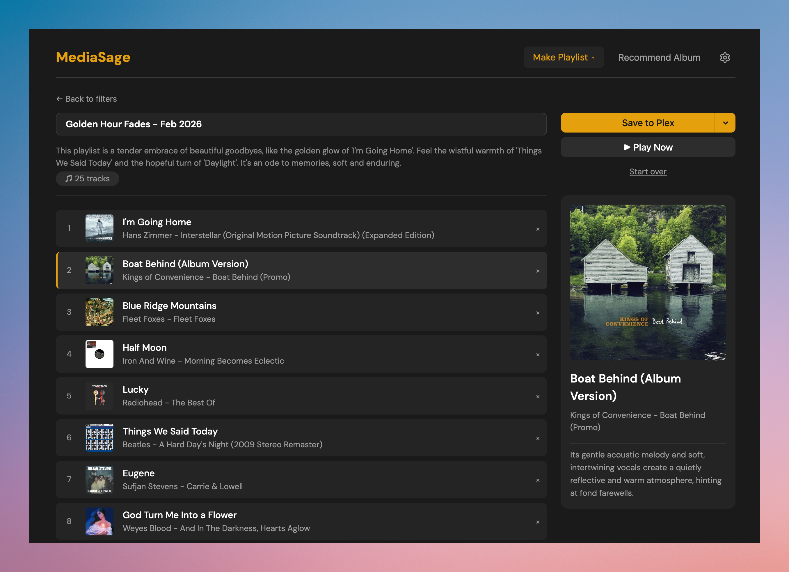
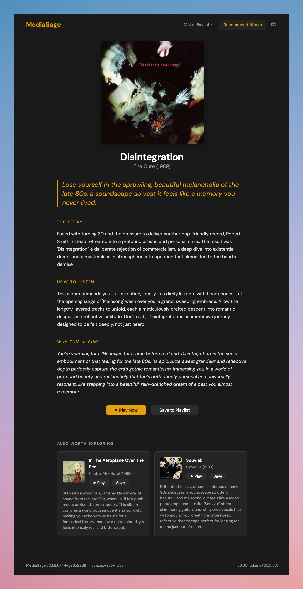
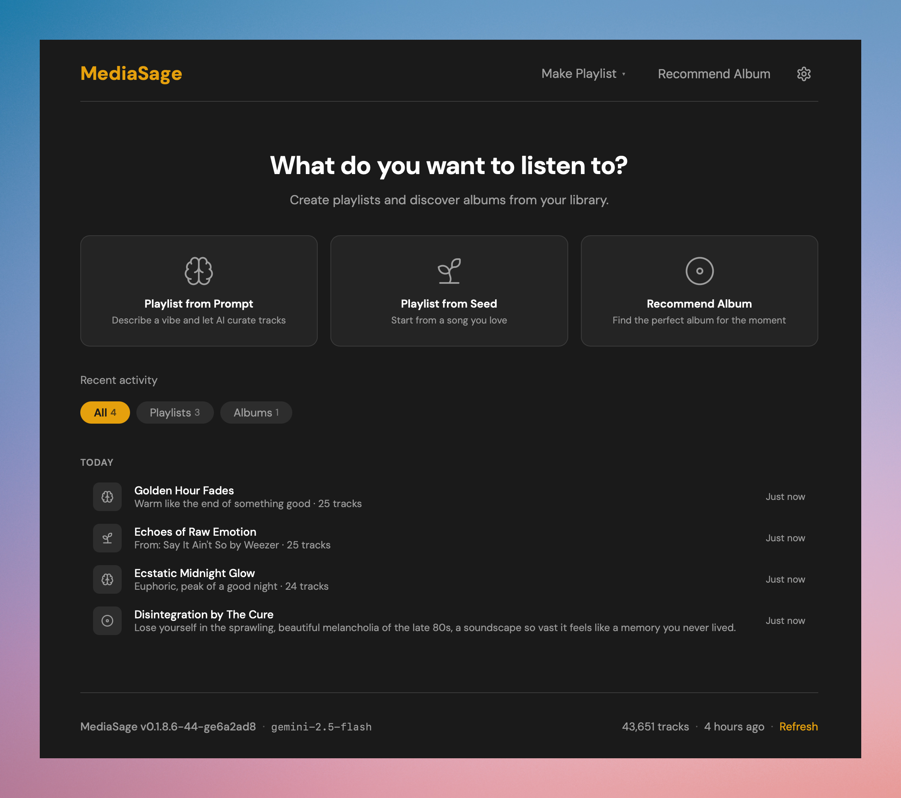
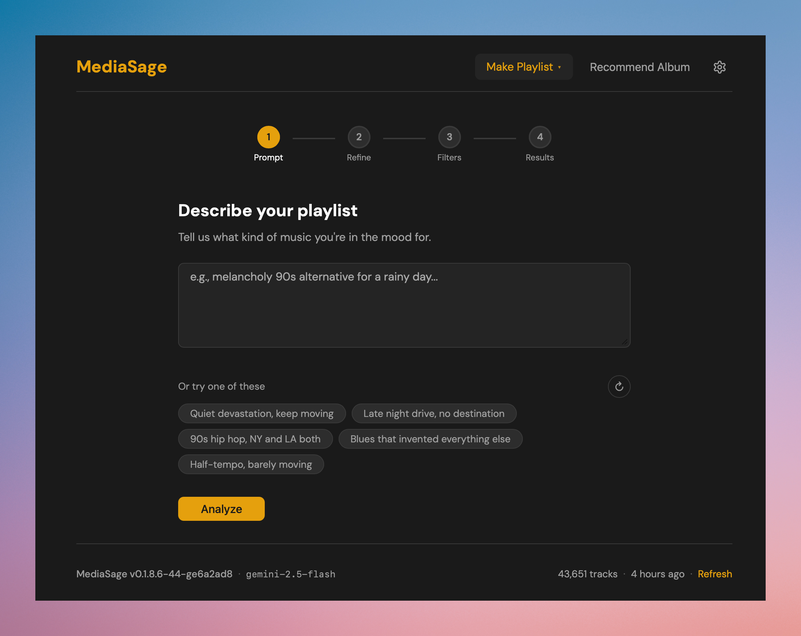
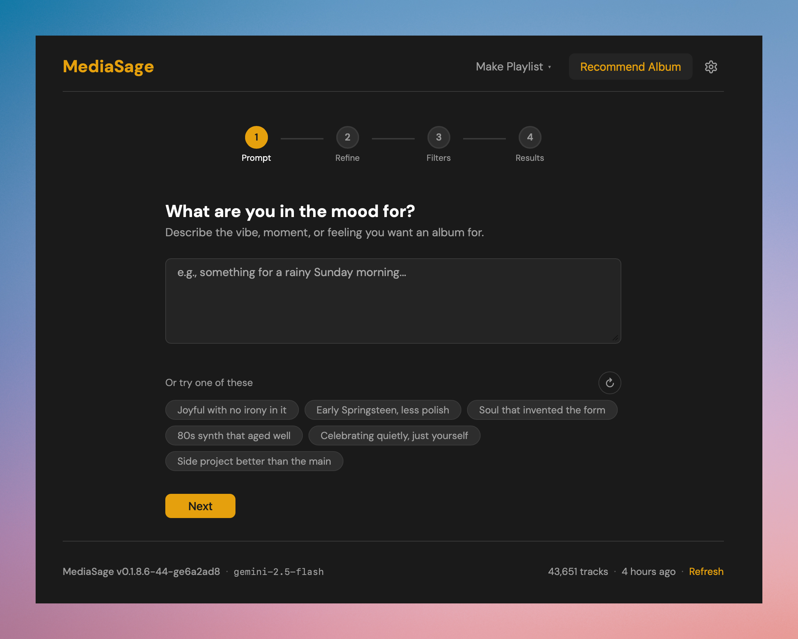

# MediaSage for Plex

[](https://opensource.org/licenses/MIT)
[](https://hub.docker.com/r/ecwilson/mediasage)
[](https://ghcr.io/ecwilsonaz/mediasage)
[](https://www.python.org/downloads/)

**AI-powered playlists and album recommendations for Plex—using only music you actually own.**

MediaSage is a self-hosted web app that creates playlists and recommends albums by combining LLM intelligence with your Plex library. Every suggestion is guaranteed playable because it only considers music you have.

*Sample Generated Playlist:*


*Sample Generated Album Recommendation:*


*Home Screen:*


*Playlist Flow:*


*Album Flow:*


---

## Quick Start

```bash
docker run -d \
  --name mediasage \
  -p 5765:5765 \
  -v mediasage-data:/app/data \
  --restart unless-stopped \
  ghcr.io/ecwilsonaz/mediasage:latest
```

Open **http://localhost:5765** — a setup wizard walks you through connecting Plex, choosing an AI provider, and syncing your library.

You can also pass credentials as environment variables to skip the wizard. See [Configuration](#configuration) for details.

**Requirements:** Docker, a Plex server with music, a [Plex token](https://support.plex.tv/articles/204059436-finding-an-authentication-token-x-plex-token/), and an API key from Google, Anthropic, or OpenAI (or a local model via Ollama).

---

## Contents

- [Why MediaSage?](#why-mediasage)
- [Features](#features)
- [Installation](#installation)
- [Configuration](#configuration)
- [How It Works](#how-it-works)
- [Development](#development)
- [API Reference](#api-reference)

---

## Why MediaSage?

**Plex users with personal music libraries have few good options for AI playlists.**

Plexamp's built-in Sonic Sage used ChatGPT to generate playlists, but it was designed around Tidal streaming. The AI recommended tracks from an unlimited catalog, and Tidal made them playable. The "limit to library" setting just hid results you didn't own—so if you asked for 25 tracks and only 4 existed in your library, you got a 4-track playlist.

When [Tidal integration ended in October 2024](https://forums.plex.tv/t/tidal-integration-with-plex-ending-october-28-2024/885728), Sonic Sage lost its foundation. Generic tools like ChatGPT have the same problem: they recommend from an infinite catalog with no awareness of what you actually own.

**MediaSage inverts the approach:**

| Filter-Last (Sonic Sage, ChatGPT) | Filter-First (MediaSage) |
|-----------------------------------|-------------------------|
| AI recommends from infinite catalog | AI only sees your library |
| Hide missing tracks after | No missing tracks possible |
| Near-empty playlists | Full playlists, every time |

The result: every track in every playlist exists in your Plex library and plays immediately.

---

## Features

### Playlist Generation

Create playlists two ways:

**Describe what you want** — Natural language prompts like:
- "Melancholy 90s alternative for a rainy day"
- "Upbeat instrumental jazz for a dinner party"
- "Late night electronic, nothing too aggressive"

**Start from a song** — Pick a track you love, then explore musical dimensions: mood, era, instrumentation, genre, production style. Select which qualities you want more of.

### Album Recommendations

Describe a mood or moment, answer two quick questions about your preferences, and get a single perfect album to listen to—with an editorial pitch explaining why it fits.

- **Library mode** — recommends albums you own, ready for instant playback
- **Discovery mode** — suggests albums you don't own yet, based on your taste profile
- **Familiarity control** — choose between comfort picks, hidden gems, or rediscoveries
- **Show Me Another** — regenerate without starting over
- Primary recommendation with a full write-up, plus two secondary picks

### Smart Filtering

Before the AI sees anything, you control the pool:
- **Genres** — Select from your library's actual genre tags
- **Decades** — Filter by era
- **Minimum rating** — Only tracks rated 3+, 4+, etc.
- **Exclude live versions** — Skip concert recordings automatically

Real-time track counts show exactly how your filters narrow results.

Optional third-party datasources add facts Plex does not carry ("most streamed", "sampled heavily",
"on a major label") to both the pool and the AI prompt — see [External Datasources](#external-datasources).

### Local Library Cache

MediaSage syncs your Plex library to a local SQLite database. After a one-time sync (~2 min for 18,000 tracks), all library operations—filtering, counting, sending to AI—happen locally in milliseconds instead of waiting on Plex.

- **Setup wizard** walks you through first-run configuration and sync
- **Footer status** shows track count and last sync time
- **Auto-refresh** keeps cache current (syncs if >24h stale)
- **Manual refresh** available anytime

### Multi-Provider Support

Bring your own API key—or run locally:

| Provider | Max Tracks | Typical Cost | Best For |
|----------|------------|--------------|----------|
| **Google Gemini** | ~18,000 | $0.03 – $0.25 | Large libraries, lowest cost |
| **Anthropic Claude** | ~3,500 | $0.15 – $0.25 | Nuanced recommendations |
| **OpenAI GPT** | ~2,300 | $0.05 – $0.10 | Solid all-around |
| **Ollama** ⚗️ | Varies | Free | Privacy, local inference |
| **Custom** ⚗️ | Configurable | Free | Self-hosted, OpenAI-compatible APIs |

⚗️ *Local LLM support is experimental. [Report issues](https://github.com/ecwilsonaz/mediasage/issues).*

> **Free option:** Google Gemini offers a free API tier that's more than enough for personal use — no credit card required. See the [Gemini free credit guide](docs/gemini-free-credit-guide.md) for setup instructions and details.

Estimated cost displays before you generate. MediaSage auto-detects your provider based on which key you configure.

### Play and Save

- **Play Now** — send tracks directly to any Plex device for instant playback
- **Create** a new playlist, **replace** an existing one, or **append** tracks to one
- **Playlist for** — save into another Plex account on your server: create it *as* that
  user (they own and manage it) or keep it as yours and put a separate copy in their library
- The playlist picker and replace/append actions follow the same selected account
- Device picker shows all active Plex clients with status indicators
- Duplicate detection when appending to existing playlists
- Preview tracks with album art before saving
- Remove tracks you don't want
- Rename the playlist
- See actual token usage and cost

### Import Spotify Playlists

Keep a playlist on Spotify? Bring it across as a Plex playlist of the songs your library can play:

- **Paste the URL** — Spotify playlist URL, `spotify:playlist:` URI or bare id
- **Fresh rows** — api.spotify.com when you configure a Spotify for Developers app pair; otherwise
  resolve the playlist from a local Annas/Spotify parquet dump
- **Matched songs** — each says how it landed: exact song, another version of it, or the same
  title/album under a different artist credit
- **Missing songs are kept** — written to the cache's `missing_songs` wish list, so you can go get
  them later; re-importing refreshes rather than stacks that list
- See [Spotify Playlist Import](#spotify-playlist-import) under Configuration for the setup

---

## Installation

### Docker Compose (Recommended)

```bash
mkdir mediasage && cd mediasage
curl -O https://raw.githubusercontent.com/ecwilsonaz/mediasage/main/docker-compose.yml
curl -O https://raw.githubusercontent.com/ecwilsonaz/mediasage/main/.env.example
mv .env.example .env
```

Edit `.env`:

```bash
PLEX_URL=http://your-plex-server:32400
PLEX_TOKEN=your-plex-token

# Choose ONE provider:
GEMINI_API_KEY=your-gemini-key
# ANTHROPIC_API_KEY=sk-ant-your-key
# OPENAI_API_KEY=sk-your-key
```

Start:

```bash
docker compose up -d
```

### NAS Platforms

<details>
<summary><strong>Synology (Container Manager)</strong></summary>

**GUI:**
1. **Container Manager** → **Registry** → Search `ghcr.io/ecwilsonaz/mediasage`
2. Download `latest` tag
3. **Container** → **Create**
4. Port: 5765 → 5765
5. Add environment variables: `PLEX_URL`, `PLEX_TOKEN`, `GEMINI_API_KEY`

**Docker Compose:**
```bash
mkdir -p /volume1/docker/mediasage && cd /volume1/docker/mediasage
curl -O https://raw.githubusercontent.com/ecwilsonaz/mediasage/main/docker-compose.yml
curl -O https://raw.githubusercontent.com/ecwilsonaz/mediasage/main/.env.example
mv .env.example .env && nano .env
```
Then in **Container Manager** → **Project** → **Create**, point to `/volume1/docker/mediasage`.

**No Docker?** Some Synology models (especially ARM-based units) don't support Docker/Container Manager. See [Bare Metal](#bare-metal-no-docker) below for running MediaSage directly with Python.

</details>

<details>
<summary><strong>Unraid</strong></summary>

1. **Docker** → **Add Container**
2. Repository: `ghcr.io/ecwilsonaz/mediasage:latest`
3. Port: 5765 → 5765
4. Add variables: `PLEX_URL`, `PLEX_TOKEN`, `GEMINI_API_KEY`

</details>

<details>
<summary><strong>TrueNAS SCALE</strong></summary>

1. **Apps** → **Discover Apps** → **Custom App**
2. Image: `ghcr.io/ecwilsonaz/mediasage`, Tag: `latest`
3. Port: 5765
4. Add environment variables

</details>

<details>
<summary><strong>Portainer</strong></summary>

**Stacks** → **Add Stack**:

```yaml
services:
  mediasage:
    image: ghcr.io/ecwilsonaz/mediasage:latest
    ports:
      - "5765:5765"
    environment:
      - PLEX_URL=http://your-server:32400
      - PLEX_TOKEN=your-token
      - GEMINI_API_KEY=your-key
    volumes:
      - ./data:/app/data
    restart: unless-stopped
```

</details>

### Bare Metal (No Docker)

Docker isn't required. MediaSage is Python + FastAPI with no native dependencies, so it runs on any machine with Python 3.11+ — including ARM-based Synology NAS models, Raspberry Pis, or any Linux/macOS/Windows box.

```bash
git clone https://github.com/ecwilsonaz/mediasage.git
cd mediasage
python -m venv venv
source venv/bin/activate
pip install -r requirements.txt
```

Set your environment variables:

```bash
export PLEX_URL=http://your-plex-server:32400
export PLEX_TOKEN=your-plex-token
export GEMINI_API_KEY=your-gemini-key
```

Start the server:

```bash
uvicorn backend.main:app --host 0.0.0.0 --port 5765
```

Access at **http://your-machine-ip:5765**.

<details>
<summary><strong>Running as a background service (systemd)</strong></summary>

To keep MediaSage running after you close your terminal, create a systemd service:

```ini
# /etc/systemd/system/mediasage.service
[Unit]
Description=MediaSage
After=network.target

[Service]
Type=simple
User=your-user
WorkingDirectory=/path/to/mediasage
EnvironmentFile=/path/to/mediasage/.env
ExecStart=/path/to/mediasage/venv/bin/uvicorn backend.main:app --host 0.0.0.0 --port 5765
Restart=on-failure

[Install]
WantedBy=multi-user.target
```

```bash
sudo systemctl enable mediasage
sudo systemctl start mediasage
```

</details>

---

## Configuration

### Environment Variables

| Variable | Required | Description |
|----------|----------|-------------|
| `PLEX_URL` | Yes | Plex server URL (e.g., `http://192.168.1.100:32400`) |
| `PLEX_TOKEN` | Yes | [Plex authentication token](https://support.plex.tv/articles/204059436-finding-an-authentication-token-x-plex-token/) |
| `GEMINI_API_KEY` | One required | Google Gemini API key |
| `ANTHROPIC_API_KEY` | One required | Anthropic API key |
| `OPENAI_API_KEY` | One required | OpenAI API key |
| `LLM_PROVIDER` | No | Force provider: `gemini`, `anthropic`, `openai`, `ollama`, `custom` |
| `PLEX_MUSIC_LIBRARY` | No | Library name if not "Music" |
| `OLLAMA_URL` | No | Ollama server URL (default: `http://localhost:11434`) |
| `OLLAMA_CONTEXT_WINDOW` | No | Override detected context window for Ollama (default: 32768) |
| `CUSTOM_LLM_URL` | No | Custom OpenAI-compatible API base URL |
| `CUSTOM_LLM_API_KEY` | No | API key for custom provider (if required) |
| `CUSTOM_CONTEXT_WINDOW` | No | Context window size for custom provider (default: 32768) |
| `EXTERNAL_SOURCES` | No | Optional third-party datasources, as JSON (see [External datasources](#external-datasources)) |
| `SPOTIFY_CLIENT_ID` | No | Spotify for Developers app id — import fetches fresh playlist rows |
| `SPOTIFY_CLIENT_SECRET` | No | Its secret; set both to use the Spotify API path |
| `SPOTIFY_PARQUET_DIR` | No | Or import from a local Annas/Spotify parquet dump (one directory per table) |

### Web UI Configuration

You can also configure MediaSage through the **Settings** page in the web UI. Settings entered there are saved to `config.user.yaml` and persist across restarts. Environment variables always take priority over UI-saved settings.

### Advanced: config.yaml

Mount a config file for additional options:

```yaml
plex:
  music_library: "Music"

llm:
  provider: "gemini"
  model_analysis: "gemini-2.5-flash"
  model_generation: "gemini-2.5-flash"
  smart_generation: false  # true = use smarter model for both (higher quality, ~3-5x cost)

defaults:
  track_count: 25
```

### External Datasources

Third-party tables — a parquet or CSV dump such as the Annas/Spotify enrichment a
companion checkout keeps beside its own library — can add facts the Plex library itself does
not carry ("most streamed", "sampled heavily", "signed to a major label"). They are optional:
with no source configured, filtering and prompts behave exactly as before, and no extra
dependency is required (parquet is read with whichever of pyarrow, pandas, polars or duckdb the
environment already has, and a stdlib CSV/JSONL reader otherwise).

```yaml
external:
  sources:
    - path: "/path/to/enriched" # one file, or a directory of them
      # level: "" # song | album | artist; empty infers it from the columns
      # key_columns: [] # columns already holding the join key
      # only_fields: [] # keep only these columns (empty = keep all)
      # drop_fields: [] # columns never to read
      # max_rows: 0 # 0 = read the whole file
  max_facts_per_track: 8 # facts written into one prompt line (0 turns that off)
  max_tracks_with_facts: 400
```

A file only has to follow the shape it already has: **one entity per row** (song, album or
artist), **the row carries its join key** — either in a column you name, or built from the
title/album/artist columns normalized the same way the library's own search does — and **every
other column is a fact**. Numbers filter with bounds, text filters by equality, arrays filter
by membership. Nothing is dataset-specific, so a column you add is filterable and prompt-
readable after the next refresh without any code change.

Keep the files outside the repo, or in `data/external/` — that path (plus `*.parquet`, `*.jsonl`)
is gitignored, since a datasource is your data, not this project's.

To **build** one from your own library and a Spotify parquet dump, `scripts/enrich_from_parquet.py`
runs the sibling checkout's DuckDB query over the dump — filtered by `data/library_cache.db`'s
`tracks` table — and then makes the same refresh the `POST /api/external/refresh` route makes, so
the facts are filterable and prompt-readable the moment the command exits:

```bash
uv run --with-requirements requirements.in scripts/enrich_from_parquet.py --check
uv run --with-requirements requirements.in scripts/enrich_from_parquet.py
```

`--check` writes nothing and prints what the cache holds, what the config names, when the last
merge ran and whether the dump's bytes can be opened. `--if-stale` re-merges only when the last
Plex sync is newer than that output — a re-sync adds tracks the merge never saw — and `--refresh-only`
re-ingests the files already on disk. `--with-playlist` opts the merge back in to reading the dump's
`playlist_tracks` table (default off, and `playlist_hit_count` then stays "not measured" rather than
0). Run it from a terminal or the notebook kernel when the dump sits on a network mount: a sandboxed
agent shell may be denied that path, and the script says so instead of reporting an empty dump.

The facts are stored beside the Plex tracks in the same SQLite cache when you re-read the files
(`POST /api/external/refresh`, which also keys the library's own rows), so they survive a library
re-sync and stay valid for another server's copy of the same music. Check what was read with
`GET /api/external/status` (rows, how many joined the library, and the catalogue of
filterable facts with the operators each accepts).

Requests then constrain those facts through `external_filters`, the sibling of the library's own
filters on `POST /api/filter/preview` and `POST /api/generate/stream`:

```json
{
  "genres": ["Rock"],
  "external_filters": [
    {"field": "popularity", "op": "min", "numbers": [1000]},
    {"field": "labels", "op": "has", "texts": ["XL Recordings"]},
    {"field": "mood", "op": "none_of", "texts": ["aggressive"]}
  ]
}
```

A fact a datasource never mentions is not excluded by default — a ban keeps the tracks the
source says nothing about, while a want requires evidence — and `keep_unknown: false` opts into
"only rows the datasource covers". `POST /api/analyze/prompt` publishes the catalogue as
`available_external_fields` and may answer a request the library's columns cannot with
`suggested_external_filters` to send back as `external_filters`.

### Spotify Playlist Import

A Spotify playlist you already keep can become a Plex playlist of the songs your library can
actually play, and everything it cannot play becomes a stored **wish list** you can act on later.
It is optional in the same way datasources are: an install that configures neither path keeps
every other route working, and the import routes answer with an error naming both remedies.

```yaml
spotify:
  # Free app pair from developer.spotify.com — fresh rows, any public playlist
  client_id: ""
  client_secret: ""
  # Or resolve the playlist from a local Annas/Spotify parquet dump instead
  # (needs duckdb installed; only playlists that snapshot captured resolve)
  parquet_dir: ""
```

Env equivalents: `SPOTIFY_CLIENT_ID`, `SPOTIFY_CLIENT_SECRET`, `SPOTIFY_PARQUET_DIR`. Credentials
win when both are configured, since they are the only path that sees the playlist as it is now.

Then `POST /api/import/spotify/preview` asks what would match without writing anything — each
matched row carries a `match_kind` saying how it landed: `exact` (same normalized song), `version`
(the same title and artist on another album), `album` (the same title and album under another
artist credit), or `search` when only live Plex search could answer. Where two library copies exist,
the one whose duration sits closest to Spotify's wins, so a deluxe-edition twin loses.

`POST /api/import/spotify` writes the Plex playlist (same `user` / `copy_to` keys as `/api/playlist`),
saves a `spotify_import` history row and records the misses in the cache's `missing_songs` table:

```json
{"playlist_ref": "https://open.spotify.com/playlist/37i9dQZF1DXcBWIGoYBM5M"}
```

Re-importing replaces that playlist's wish rows rather than stacking them, so a playlist that is
now fully matched clears its old wish; other playlists' wishes stay intact. Nothing matched is not
an error — you get `success: false` with the wish list written and no empty Plex playlist.
Read the wish list back with `GET /api/import/spotify/missing?limit=&offset=`, which pages the rows
and summarizes each playlist that imported.

### Model Selection

MediaSage uses a two-model strategy by default:

| Role | Purpose | Models Used |
|------|---------|-------------|
| **Analysis** | Interpret prompts, suggest filters, analyze seed tracks | claude-sonnet-4-5 / gpt-4.1 / gemini-2.5-flash |
| **Generation** | Select tracks from filtered list | claude-haiku-4-5 / gpt-4.1-mini / gemini-2.5-flash |

This balances quality with cost. Enable `smart_generation: true` to use the analysis model for everything.

### Local LLM Setup (Experimental)

Run MediaSage with local models for privacy and zero API costs.

<details>
<summary><strong>Ollama</strong></summary>

1. Install [Ollama](https://ollama.ai) and pull a model:
   ```bash
   ollama pull llama3:8b
   ```

2. Configure MediaSage via environment or Settings UI:
   ```bash
   LLM_PROVIDER=ollama
   OLLAMA_URL=http://localhost:11434
   ```

3. Select your model in Settings → the context window is auto-detected.

**Recommended models:** `llama3:8b`, `qwen3:8b`, `mistral` — models with 8K+ context work best.

</details>

<details>
<summary><strong>Custom OpenAI-Compatible API</strong></summary>

For LM Studio, text-generation-webui, vLLM, or any OpenAI-compatible server:

1. Start your server with an OpenAI-compatible endpoint

2. Configure in Settings:
   - **API Base URL:** `http://localhost:5000/v1`
   - **API Key:** If required by your server
   - **Model Name:** The model identifier
   - **Context Window:** Your model's context size

</details>

**Note:** Local models are slower and may produce less accurate results than cloud providers. A 10-minute timeout is used for generation. Models with larger context windows will support more tracks.

---

## How It Works

MediaSage uses a **filter-first architecture** designed for large libraries (50,000+ tracks):

```
┌─────────────────────────────────────────────────────────────────┐
│  1. ANALYZE                                                      │
│     LLM interprets your prompt → suggests genre/decade filters   │
├─────────────────────────────────────────────────────────────────┤
│  2. FILTER                                                       │
│     Plex library narrowed to matching tracks                     │
│     "90s Alternative" → 2,000 tracks                             │
├─────────────────────────────────────────────────────────────────┤
│  3. SAMPLE                                                       │
│     If too large for context, randomly sample                    │
│     Fits within model's token limits                             │
├─────────────────────────────────────────────────────────────────┤
│  4. GENERATE                                                     │
│     Filtered track list + prompt sent to LLM                     │
│     LLM selects best matches from available tracks               │
├─────────────────────────────────────────────────────────────────┤
│  5. MATCH                                                        │
│     Fuzzy matching links LLM selections to library               │
│     Handles minor spelling/formatting differences                │
├─────────────────────────────────────────────────────────────────┤
│  6. SAVE                                                         │
│     Playlist created in Plex                                     │
│     Ready in Plexamp or any Plex client                          │
└─────────────────────────────────────────────────────────────────┘
```

This ensures every track exists in your library while keeping API costs manageable.

---

## Development

### Local Setup

```bash
git clone https://github.com/ecwilsonaz/mediasage.git
cd mediasage
python -m venv venv
source venv/bin/activate
pip install -r requirements.txt

export PLEX_URL=http://your-plex-server:32400
export PLEX_TOKEN=your-plex-token
export GEMINI_API_KEY=your-key

uvicorn backend.main:app --reload --port 5765
```

### Testing

```bash
pytest tests/ -v
```

### Manual Backend Notebook

`notebooks/manual_backend.ipynb` runs the backend pipeline by hand — it calls
the same functions as the HTTP routes, with editable cells for Plex/LLM config,
library sync, prompt analysis, filter preview, streaming generation, seed-track
analysis, and saving playlists to Plex. Handy for debugging without the web UI.

```bash
pip install jupyter        # pandas optional, for the results table
jupyter lab notebooks/manual_backend.ipynb
```

Run cells top-down and edit the values in the **Configuration** cells. Values
default from `.env`, so nothing secret is stored in the notebook.

### Tech Stack

- **Backend:** Python 3.11+, FastAPI, python-plexapi, rapidfuzz, httpx
- **Frontend:** Vanilla HTML/CSS/JS (no build step)
- **LLM SDKs:** anthropic, openai, google-genai (+ Ollama via REST API)
- **Deployment:** Docker

---

## API Reference

Interactive documentation available at `/docs` when running.

`INTERFACES.md` (repo root) is the full contract surface — every route with its request/response
models, the module-level Python API, the SQLite schema, the frontend surface and the config chain —
written so an agent can work against the repo without opening the sources.

| Endpoint | Method | Description |
|----------|--------|-------------|
| `/api/health` | GET | Health check |
| `/api/config` | GET/POST | Get or update configuration |
| `/api/setup/status` | GET | Onboarding checklist state |
| `/api/setup/validate-plex` | POST | Validate Plex credentials |
| `/api/setup/validate-ai` | POST | Validate AI provider credentials |
| `/api/setup/complete` | POST | Mark setup wizard as complete |
| `/api/library/stats` | GET | Library statistics |
| `/api/library/status` | GET | Cache state, track count, sync progress |
| `/api/library/sync` | POST | Trigger background library sync |
| `/api/library/search` | GET | Search library tracks |
| `/api/analyze/prompt` | POST | Analyze natural language prompt |
| `/api/analyze/track` | POST | Analyze a seed track |
| `/api/filter/preview` | POST | Preview filtered track list |
| `/api/generate` | POST | Generate playlist |
| `/api/generate/stream` | POST | Stream playlist generation (SSE) |
| `/api/playlist` | POST | Save playlist to Plex (optionally for another user) |
| `/api/playlist/update` | POST | Replace or append to a playlist |
| `/api/recommend/albums/preview` | GET | Preview album candidates for filters |
| `/api/recommend/analyze-prompt` | POST | Analyze prompt for genre/decade filters |
| `/api/recommend/questions` | POST | Generate clarifying questions |
| `/api/recommend/generate` | POST | Generate album recommendations |
| `/api/recommend/switch-mode` | POST | Switch library/discovery mode |
| `/api/results` | GET | List saved result history |
| `/api/results/{id}` | GET/DELETE | Get or delete a saved result |
| `/api/plex/clients` | GET | List active Plex clients |
| `/api/plex/playlists` | GET | List playlists for a Plex user (`?user=`) |
| `/api/plex/users` | GET | List Plex accounts that can own playlists |
| `/api/play-queue` | POST | Send tracks to a Plex client |
| `/api/external/status` | GET | External datasource state: rows read, joins, filterable facts |
| `/api/external/refresh` | POST | Re-read the configured datasources into the cache |
| `/api/import/spotify/preview` | POST | Match a Spotify playlist against the library, write nothing |
| `/api/import/spotify` | POST | Import a Spotify playlist as a Plex playlist (+ wish list of misses) |
| `/api/import/spotify/missing` | GET | The stored wish list: songs imported playlists asked for but lack |
| `/api/art/{rating_key}` | GET | Proxy album art from Plex |
| `/api/ollama/status` | GET | Ollama connection status |
| `/api/ollama/models` | GET | List available Ollama models |
| `/api/ollama/model-info` | GET | Get model details (context window) |

### Saving Playlists for Another Plex User

`GET /api/plex/users` lists the Plex accounts that can own a playlist on your server —
the connected account first (key `__owner__`), then everyone shared into it. Pass that key
to the playlist endpoints:

| Field | Endpoints | Meaning |
|---|---|---|
| `user` | `/api/playlist`, `/api/playlist/update`, `/api/plex/playlists` | Which account owns the playlist (`__owner__` = the account `PLEX_TOKEN` belongs to) |
| `copy_to` | `/api/playlist` | Extra accounts that each get their own copy in their own library |

Writing as another user requires that server to be shared with them: MediaSage connects
as them (admin-only `switchUser`), so the playlist lands in their library owned by them.
Plex has no server-side user-to-user playlist share, so `copy_to` creates a separate copy
per account and skips tracks that account cannot see. Replace and append stay inside the
one selected account, and the response's `owner` and `copies` fields report who got what.

---

## License

MIT
